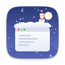
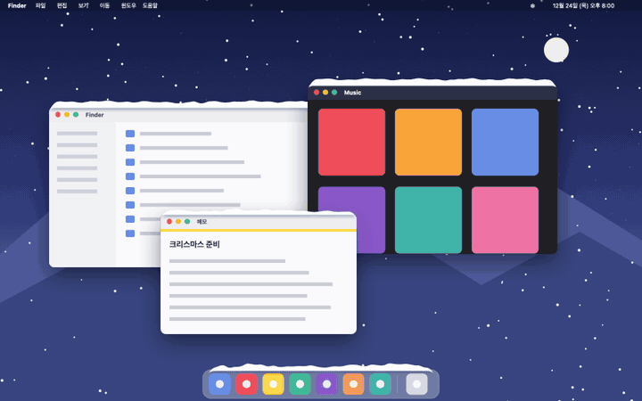
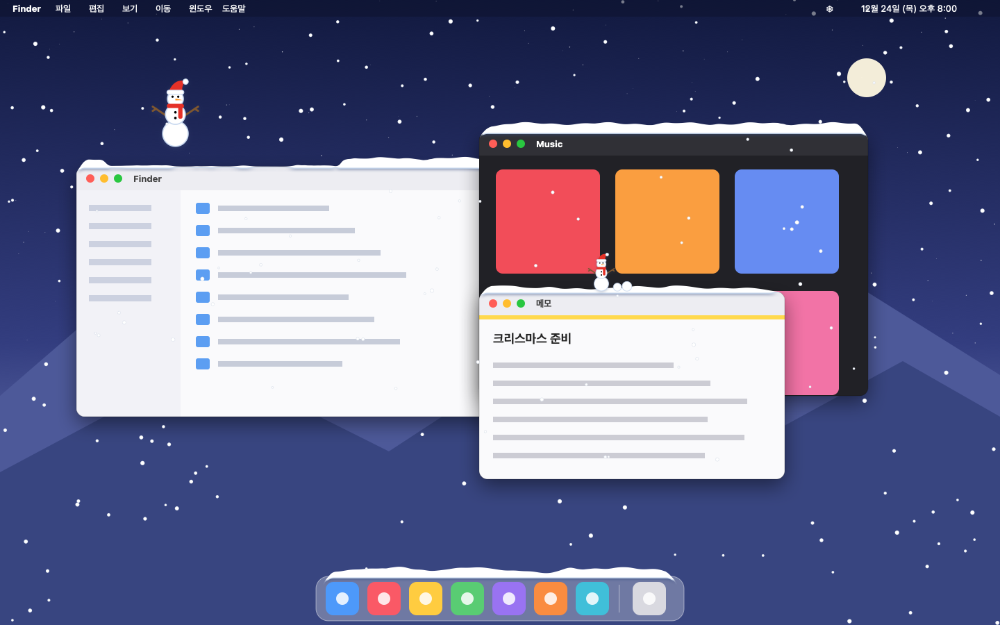
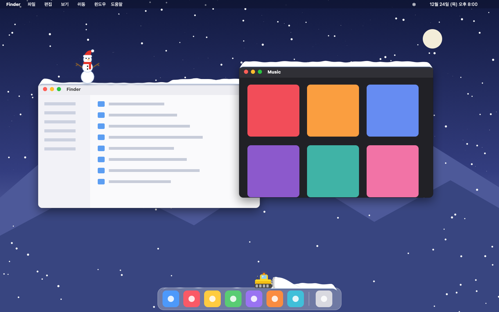
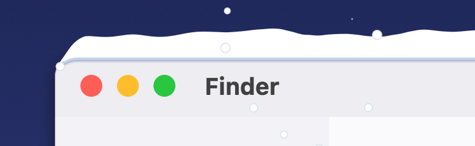
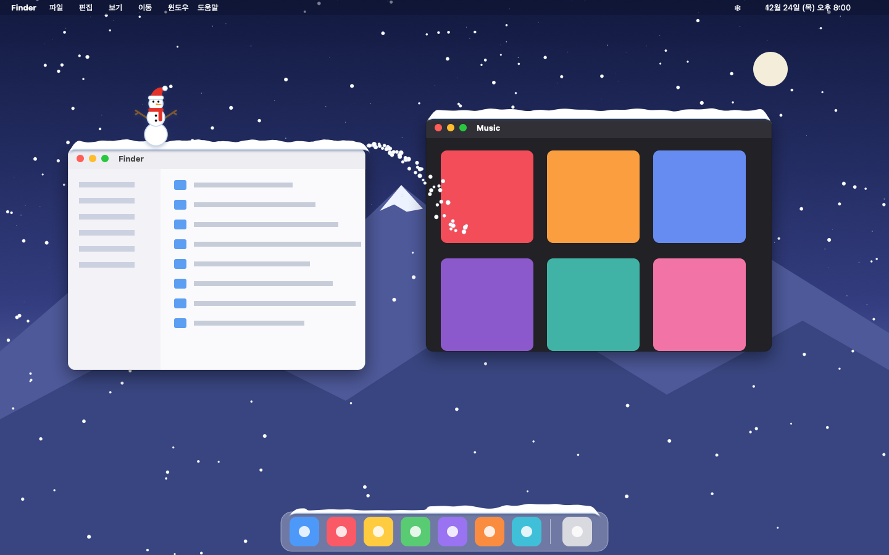
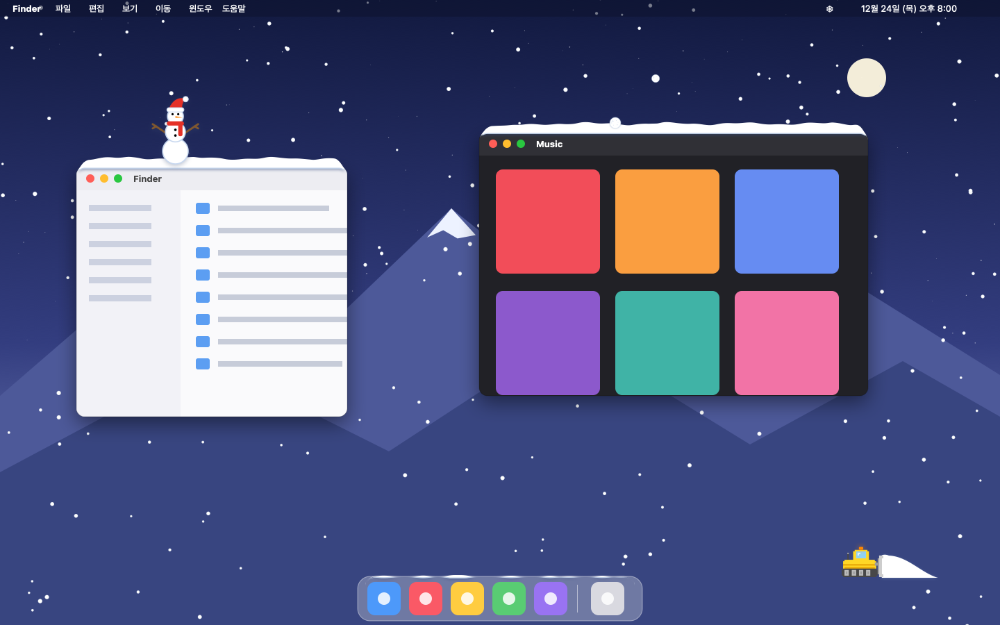
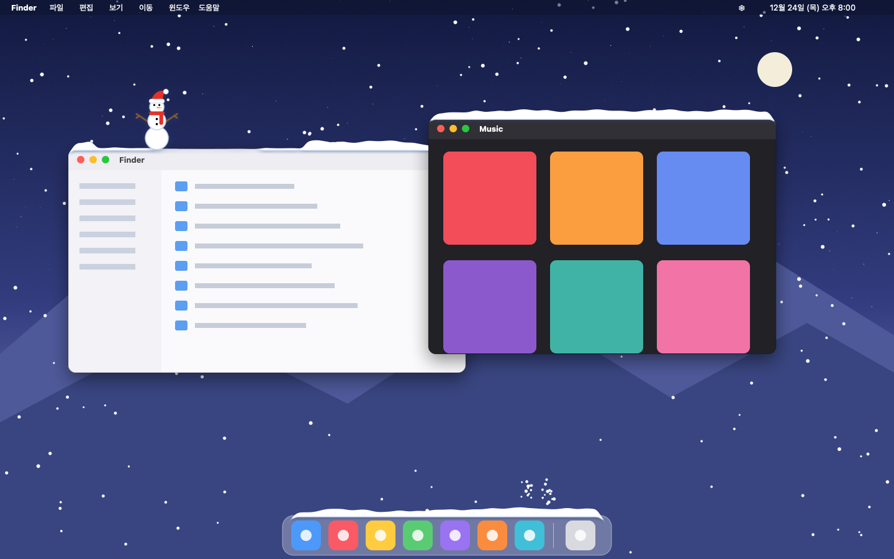
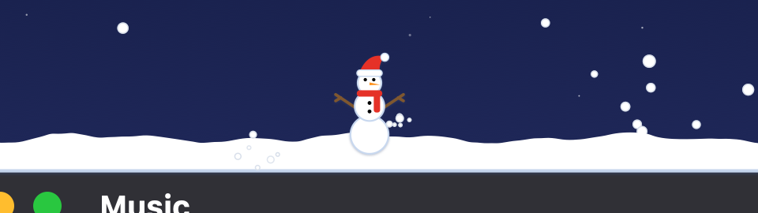
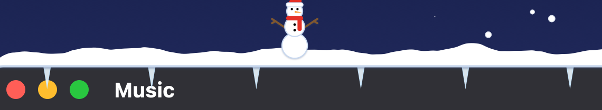

# MacSnow ❄



맥 화면에 눈이 내리고, 창 윗면과 Dock 위에 눈이 소복이 쌓이는 메뉴바 앱이에요.
인스타그램 릴스에서 본 크리스마스 데스크톱 효과를 보고 처음부터 새로 만들었어요(원본 영상의 이미지·에셋은 쓰지 않았어요).

- Swift + AppKit + Core Animation (+ [Sparkle 2](https://sparkle-project.org/) 자동 업데이트)
- Xcode 없이 Command Line Tools만으로 빌드 (`tools/fetch_sparkle.sh`가 Sparkle 2 바이너리를 자동 다운로드·검증)
- 앱 아이콘 원본은 `Resources/AppIcon.svg`, `Resources/AppIcon.icns`는 `tools/make_icns.py`로 만들어요
- Dock 아이콘 없이 메뉴바 ❄ 아이콘으로만 동작

## 다운로드

**[최신 버전 받기 (DMG / ZIP)](https://github.com/ColdTbrew/mac-snow/releases/latest)**

1. `MacSnow-<버전>.dmg`를 받아 열고, MacSnow를 Applications 폴더로 끌어다 놓아요.
2. 개발자 서명·공증이 없는 앱이라 처음 열 때 막힐 수 있어요. 그러면 한 번 열기를 시도한 뒤 **시스템 설정 > 개인정보 보호 및 보안**에서 **그래도 열기**를 누르거나, 터미널에서 아래를 실행해요.
   ```
   xattr -dr com.apple.quarantine /Applications/MacSnow.app
   ```
3. 메뉴바에 ❄가 생기면 끝이에요. (macOS 13 이상, Apple Silicon·Intel)

직접 빌드하려면 아래 [설치·실행](#설치실행)을 봐 주세요.

## 기능

- **눈 내리기**: 화면 전체에 하얀 눈송이가 좌우로 살랑살랑 흔들리며 천천히 내려요. 작은 눈송이는 멀리 있는 것처럼 더 느리고 흐리게 내려서 깊이감이 있어요. 내리는 눈송이는 앱 창 뒤(바탕화면 위)로 지나가서 창 내용을 가리지 않아요. 창 윗면이나 Dock에 닿은 눈은 앞쪽에 쌓여 보여요. 클릭은 전부 그대로 통과해요.
- **창·Dock 위에 쌓임**: 눈송이가 창 윗면이나 Dock 윗면에 닿으면 그 자리에 쌓여요. 창이 겹쳐 있으면 일부는 뒤쪽 창이나 Dock까지 떨어져요. 앞 창에 가려진 부분은 그 창의 둥근 모서리 모양대로 가려지고, 창 위 눈 더미 끝은 모서리를 따라 자연스럽게 얇아져요. Dock 위 눈은 둥근 양 끝보다 안쪽의 평평한 윗변에 맞춰 조금 더 좁게 쌓이고 끝부분이 매끄럽게 0으로 얇아져 바깥으로 삐져나오지 않아요.
- **Dock 실제 크기 따라가기**: 손쉬운 사용 권한이 있으면 실제 Dock 크기와 위치에 맞춰 눈이 쌓여요. 권한이 없으면 Dock 설정과 실행 중인 앱으로 크기를 추정해요.
- **창을 좁히면 눈이 떨어짐**: 왼쪽이나 오른쪽 가장자리로 창을 좁히면 넘친 눈이 아래로 떨어져 다른 창이나 Dock에 쌓여요. Dock 폭이 줄어들 때도 바깥쪽 눈이 떨어져요.
- **창 드래그 따라가기**: 창을 끌고 다니면 쌓인 눈과 눈사람이 마우스 움직임에 맞춰 바로 따라오고, 옮긴 자리에서도 계속 쌓여요.
- **눈 굴려 눈사람 만들기**: 창 위에 쌓인 눈을 마우스로 좌우로 문지르듯 드래그하면 눈덩이가 굴러가며 커지고, 지나간 자리의 눈은 줄어요. 충분히 크면 손을 놓는 순간 눈사람이 뿅 하고 생기고, 작으면 눈덩이로 남아요. 눈사람은 산타 모자·털모자(비니)·양동이·중절모와 여러 색 목도리가 랜덤으로 조합돼요. (창 자체가 움직이면 창 드래그로 보고 굴리기를 취소해요.)
- **제목줄 클릭 눈사람**: 창 제목줄(위쪽 약 28pt)을 클릭하면 그 자리에 랜덤 소품을 쓴 눈사람이 톡 떨어져 서요. 눈사람을 클릭하면 눈가루가 뿅 흩어지면서 사라져요.
- **눈덩이 옮겨 쌓기**: 굴려 둔 눈덩이를 마우스로 집어 다른 눈덩이 위에 놓으면 둘이 합쳐져 눈사람이 돼요(큰 쪽이 아래). 빈 곳에 놓으면 아래에 있는 창이나 Dock으로 떨어져요. 눈덩이를 그냥 클릭하면 지금처럼 폴짝 뛰어요.
- **눈덩이 던지기 · 눈싸움**: 눈덩이를 마우스로 집어 빠르게 휘둘러 놓으면 포물선을 그리며 날아가요(잠시 멈췄다가 놓으면 살며시 떨어져요). 날아간 눈덩이가 눈사람에 맞으면 눈가루를 흩뿌리며 사라지고, 다른 눈덩이에 맞으면 맞은 눈덩이가 폴짝 뛰어요. 창이나 Dock에 닿으면 '퍽' 하고 눈가루가 튀며 작은 눈더미가 쌓여요.
- **창 흔들어 눈 털기**: 창 제목줄을 잡고 좌우(또는 위아래)로 빠르게 흔들면 한 번 방향을 틀 때마다 쌓인 눈이 덩어리째 털려 나가요. 털린 눈은 창이 움직이던 방향으로 날아가 아래 창이나 Dock에 떨어지고, 고드름도 같이 부러져요. 세게 흔들면 눈사람과 눈덩이도 빙글 돌며 떨어져요. 한 번 왔다 갔다 하며 창 위치를 맞추는 정도로는 털리지 않아요. 메뉴에서 켜고 끌 수 있어요.
- **창을 닫으면 떨어짐**: 눈사람이 서 있던 창이 닫히거나 사라지면 아래로 떨어지고, Dock에 부딪히면 '퍽' 하고 눈가루로 흩어지면서 Dock 위에 눈이 조금 더 쌓여요.
- **미션 컨트롤에서는 숨김**: 미션 컨트롤(창 모아보기)이 열리면 창·Dock 위 눈과 눈사람이 살짝 사라졌다가, 닫으면 그대로 다시 나타나요. 그동안 창 크기가 줄어든 걸로 오해해 눈이 흐트러지거나 떨어지지 않아요.
- **전체화면에서는 자동 숨김**: 유튜브 전체화면 등 전체화면 동영상·앱이 실행되면 해당 디스플레이의 눈·눈사람·Dock 눈·눈송이·모닥불이 자동으로 숨겨지고, 전체화면을 빠져나오면 쌓여 있던 눈과 눈사람이 그대로 다시 나타나요. 메뉴에서 켜고 끌 수 있어요.
- **눈이 초기화되지 않음**: 쌓인 눈과 눈사람은 앱을 다시 켜도(30분 이내), 창을 최소화하거나 다른 Space로 옮겨도 그대로 남아 있어요.
- **마우스 바람**: 마우스를 빠르게 휘두르면 그 근처에서 내리던 눈송이가 마우스가 움직인 쪽으로 밀려요. 쌓인 눈 위를 빠르게 지나가면 눈가루가 조금 흩날리고, 그만큼 쌓인 눈이 아주 조금 줄어요. 메뉴에서 켜고 끄거나 세기(약하게·보통·세게)를 고를 수 있어요.
- **녹기·고드름**: 쌓인 지 3분이 지난 눈은 천천히 녹아요. 녹은 물로 창 윗변 아래에 길이가 다른 고드름이 하나씩 또는 몇 개씩 모여 맺히고, 고드름 끝에서 물방울이 똑똑 떨어져 아래 창이나 Dock 위에서 톡 튀어요. 고드름을 클릭하거나 마우스로 빠르게 스치면 얼음 조각으로 부러져 떨어지며 산산이 흩어지고, 눈이 다 녹으면 고드름도 줄어들어요. 메뉴에서 켜고 끄거나 녹는 속도(느리게·보통·빠르게, 분당 약 0.4·1.2·3pt)를 고를 수 있어요.
- **모닥불 모드**: 메뉴에서 **모닥불 모드**를 켜면 마우스 커서가 장작과 불꽃이 타오르는 모닥불로 바뀌어요. 커서를 세게 흔들면 불꽃이 잠깐 잦아들고, 멈추면 다시 타올라요. 커서를 쌓인 눈·고드름·눈사람·눈덩이 가까이로 가져가면 열기로 실시간으로 녹고, 녹은 눈이 맑은 물방울이 되어 창과 Dock 아래로 흘러내리며 아래 창에 닿으면 톡톡 튀어요. 모닥불이 켜진 동안에도 일반 클릭·창 드래그는 그대로 통과하고, 실수로 눈사람이 생기지 않도록 제목줄 클릭 눈사람 생성과 눈 굴리기는 잠시 쉬어요.
- **배터리 절약**: 자동으로 두면 전원 어댑터가 빠져 있거나 저전력 모드일 때 눈 양과 갱신 횟수를 줄여요(폭설은 '많이'로 낮춰요). 항상 켜 두거나 끌 수도 있어요.
- **로그인 시 자동 실행**: 메뉴에서 켜면 로그인할 때 MacSnow가 자동으로 실행돼요(`SMAppService`).
- **자동 업데이트**: [Sparkle 2](https://sparkle-project.org/)로 GitHub Releases의 새 버전을 확인하고 바로 업데이트할 수 있어요. 메뉴바 ❄ > **업데이트 확인…**으로 수동 확인하거나 **자동 업데이트 확인**을 켜고 끌 수 있어요. (v0.5.2부터 다시 동작해요. v0.5.0–0.5.1은 업데이트 키가 빠진 채 배포돼서, 그 버전을 쓰고 있다면 v0.5.2를 한 번 직접 내려받아 주세요.)
- **제설차**: 노란 픽셀 제설차가 가끔 Dock 위를 지나가며 눈을 밀어요. 밀린 눈은 날 앞에 쐐기 모양으로 모여 같이 움직여요. 메뉴에서 바로 부를 수도 있어요.

## 스크린샷

> 스크린샷과 데모 GIF는 실제 화면을 캡처한 게 아니라, 코드로 그린 가상 화면(배경·메뉴바·Dock·가짜 창)에 실제 눈 엔진을 돌려 렌더링한 거예요.

| 눈이 쌓인 창과 Dock | 눈 굴려 만든 눈사람 · 제목줄 클릭 눈사람 |
|---|---|
|  |  |
| **제설차가 Dock 눈을 밀어 모음** | **눈 더미 끝이 창 모서리를 따라 얇아짐 (확대)** |
|  |  |
| **창을 좁히면 넘친 눈이 아래로 떨어짐** | **눈덩이를 집어 다른 눈덩이 위로 옮기는 중** |
|  |  |
| **창이 닫혀 떨어진 눈사람이 Dock에서 '퍽'** | **마우스 바람에 흩날리는 눈가루 (확대)** |
|  |  |
| **녹으면서 창 윗변 아래에 맺힌 고드름 (확대)** | |
|  | |

## 요구사항

- macOS 13 Ventura 이상 (빌드 최소 타깃 13.0. 실제로 테스트한 환경은 macOS 27.2 / Apple Silicon)
- Apple Silicon, Intel 모두 지원 (`build.sh`가 유니버설 바이너리를 만들어요. Intel 맥에서 실행해 보지는 않았어요)
- Command Line Tools: 없으면 터미널에서
  ```
  xcode-select --install
  ```

## 설치·실행

```
git clone https://github.com/ColdTbrew/mac-snow.git
cd mac-snow
./build.sh --run
```

`build/MacSnow.app`이 만들어지고 바로 실행돼요. 계속 쓰려면 응용 프로그램 폴더로 옮겨 두세요.

```
cp -R build/MacSnow.app /Applications/
open /Applications/MacSnow.app
```

직접 빌드한 앱이라(애드혹 서명) 처음 열 때 경고가 뜨면 Finder에서 앱을 우클릭 → 열기를 눌러 주세요.

## 원활한 조작 팁 (macOS 설정)

눈사람 클릭·눈 굴리기·눈덩이 집어 던지기를 할 때 창 윗변 바깥(배경화면 영역)으로 클릭이 통과하면서 모든 창이 옆으로 밀린다면, macOS의 데스크탑 보기 설정을 아래처럼 바꿔 주세요.

- **시스템 설정 > 데스크탑 및 Dock > 배경화면을 클릭하여 데스크탑 보기** → **스테이지 매니저에서만** (영문: *System Settings > Desktop & Dock > Click wallpaper to reveal desktop → Only in Stage Manager*)

## 권한

- **화면 기록 권한은 필요 없어요.** 창 위치(크기·좌표)만 읽고, 창 제목이나 내용은 읽지 않아요.
- **손쉬운 사용 권한은 선택 사항이에요.** Dock의 실제 프레임(위치·크기)만 읽는 데 사용해요. 권한이 없으면 새 빌드를 처음 실행할 때 한 번 시스템 권한 요청 창을 띄워요(거절해도 다시 묻지 않아요). 나중에 메뉴바 ❄ > **Dock 크기 정확히 맞추기 (손쉬운 사용 권한)**에서 다시 요청할 수 있어요. 권한이 없어도 추정 크기로 안전하게 동작해요. 애드혹 서명으로 다시 빌드하면 기존 권한이 무효화되므로, 정확한 AX Dock 추적을 원하면 **시스템 설정 > 개인정보 보호 및 보안 > 손쉬운 사용**에서 MacSnow를 껐다 다시 켜 주세요.
- 클릭·드래그는 전역 마우스 이벤트 모니터로 감지해요. 마우스 이벤트는 보통 추가 권한 없이 동작해요. 혹시 제목줄 클릭이나 눈 굴리기에 반응이 없으면 시스템 설정 > 개인정보 보호 및 보안 > 손쉬운 사용에서 MacSnow를 허용해 보세요.
- **네트워크 연결은 업데이트 확인에만 써요.** Sparkle 2가 GitHub Releases의 `appcast.xml`을 확인하고 새 버전을 내려받는 데만 사용하며, 다른 데이터나 분석 정보는 보내지 않아요. 메뉴바 ❄ > **자동 업데이트 확인**을 끄면 자동 네트워크 요청도 하지 않아요.

## 메뉴바 ❄ 팝오버

메뉴바의 눈송이 아이콘을 누르면 macOS Liquid Glass(macOS 13~15에서는 반투명 블러 폴백) 플로팅 패널에서 모든 설정과 빠른 실행 버튼을 바로 조작할 수 있어요.

| 항목 | 설명 |
|---|---|
| 눈 내리기 | 눈 켜기/끄기 |
| 세기 | 가랑눈 / 보통 / 많이 / 폭설 |
| 마우스 바람 | 마우스를 빠르게 움직이면 눈송이가 밀리고 쌓인 눈에서 눈가루가 날림 (기본: 켜짐) |
| 바람 세기 | 약하게 / 보통 / 세게 |
| 창 흔들어 눈 털기 | 제목줄을 잡고 창을 빠르게 흔들면 쌓인 눈과 눈사람이 털려 떨어짐 (기본: 켜짐) |
| 눈 털기 강도 | 약하게(기존 강도) / 보통(기본) / 세게. 방향을 틀 때마다 털리는 눈의 양을 조절해요. |
| 녹기·고드름 | 쌓인 눈이 천천히 녹고 고드름·물방울이 맺히며 클릭·스치기로 부러뜨릴 수 있음 (기본: 켜짐) |
| 녹는 속도 | 느리게 / 보통 / 빠르게 |
| 모닥불 모드 | 마우스 커서가 모닥불이 되어 가까이 가면 눈·고드름·눈사람이 녹아 물이 되어 흘러내림 (기본: 꺼짐) |
| 배터리 절약 | 자동(배터리 사용 중이거나 저전력 모드일 때만) / 항상 / 끄기 |
| 로그인 시 자동 실행 | 로그인할 때 자동으로 실행 (기본: 꺼짐) |
| 눈사람 | 제목줄 클릭·눈 굴리기로 눈사람 만들기 켜기/끄기 |
| 제설차 자동 | Dock에 눈이 쌓이면 제설차가 가끔 알아서 지나가기 |
| 눈송이 창 위로 | 켜면 예전처럼 내리는 눈송이를 모든 창 앞에 그려요 (기본: 꺼짐 = 창 뒤) |
| 전체화면에서 숨기기 | 유튜브 전체화면 등 전체화면 동영상·앱 위에서 눈과 Dock 눈을 자동으로 숨김 (기본: 켜짐) |
| Dock 크기 정확히 맞추기 (손쉬운 사용 권한) | 권한이 없을 때 표시, 실제 Dock 프레임 읽기 권한 요청 |
| 지금 Dock 제설 | 제설차 바로 부르기 |
| 앞 창에 눈사람 놓기 | 맨 앞 창들에 눈사람 바로 놓기 |
| 눈 치우기 | 쌓인 눈과 눈사람 모두 지우기 |
| 업데이트 확인… | Sparkle로 GitHub Releases 최신 버전 확인 |
| 자동 업데이트 확인 | 주기적인 자동 업데이트 확인 켜기/끄기 (공개 키가 포함된 릴리스 빌드에서 활성화) |
| 종료 | 앱 종료 |

설정은 저장돼서 다음에 켜도 유지돼요. 로그인 시 자동 실행은 macOS 로그인 항목 설정을 그대로 따라요.

## 로그인 시 자동 실행

메뉴바 ❄ > **로그인 시 자동 실행**을 켜면 돼요. macOS가 승인을 요구하면 로그인 항목 설정 화면이 열려요. 앱은 `/Applications`에 넣어 두고 켜는 게 좋아요. 직접 하려면 시스템 설정 > 일반 > 로그인 항목 > 로그인 시 열기 목록의 **+** 버튼을 눌러 `/Applications/MacSnow.app`을 추가하세요.

## 리소스

가볍게 돌도록 신경 썼어요.

- 눈송이 움직임은 Core Animation이 GPU에서 처리하고, CPU는 눈송이 생성과 착지 처리만 해요.
- 필요한 만큼만 갱신해요: 평소 눈 내릴 때 초당 4번, 눈사람·제설차·눈 굴리기 애니메이션 중 30번, 마우스를 누르고 있을 때만 60번. 눈을 끄면 창이 움직인 직후 2초 동안 4번, 가만히 있으면 2번, 쌓인 눈도 없으면 1번.
- 창 위치는 창이 움직인 직후 2초 동안 초당 약 4번, 가만히 있으면 2번 읽고, 앱이 바뀌면 바로 한 번 읽어요. 드래그 중에는 잡은 창만 초당 60번 읽어요.
- 쌓인 눈 다듬기(relax)는 높이가 실제로 바뀔 때만 다시 그려요.
- 눈 더미 모양은 높이가 바뀐 창만 다시 그려요. 창이 움직이면 레이어 위치만 옮겨요.
- 화면 잠금, 디스플레이 잠자기, 사용자 전환 중에는 완전히 멈춰요.
- 배터리 절약(기본: 자동)이 켜지면 눈 양과 갱신 횟수를 절반으로 줄이고, 마우스를 누르고 있을 때도 초당 30번만 갱신해요.
- 마우스 바람은 마우스 이동 이벤트마다 속도만 계산하고, 빠를 때만 초당 최대 15번 바람을 일으켜요. 바람을 끄면 이동 이벤트 감시도 꺼져요.
- 녹기·고드름은 2초에 한 번만 계산해요. 동시에 내리는 눈송이는 최대 700개로 제한해요.

측정값 (Apple Silicon 맥, 5K 외장 디스플레이, macOS 27.2, 열린 창 약 18개, 세기 보통):

| 상황 | CPU 평균 | 메모리 |
|---|---|---|
| 눈 내리는 중, 가만히 (60초) | 2.6% | 17MB |
| 창 드래그 중 (60Hz 추적, 10초) | 5.8% | 17MB |
| 제설차 지나가는 중 (15초) | 2.5% | 17MB |
| 눈 끔, 쌓인 눈만 남음 (30초) | 0.6% | 18MB |
| 눈 끔 + 눈 치움 (20초) | 0.1% | 18MB |
| 화면 잠금 중 (자동 일시정지) | 0.0% | 13MB |

`top -l N -s 1 -stats cpu,mem,power`로 잰 MacSnow 프로세스의 평균값이에요. 화면 합성은 WindowServer/GPU 쪽에서 처리되므로 이 표에는 포함되지 않아요.

v0.5.1 유휴 비용 줄이기 전/후 (같은 맥, 화면 잠금 상태에서 `--nopause`, 시나리오당 30초 × 3회 평균, `proc_pid_rusage`로 측정):

| 상황 | CPU 평균 | wakeups/s | 에너지 (mJ/s) |
|---|---|---|---|
| 눈 내리는 중 | 1.92% → 1.34% | 8.1 → 4.0 | 4.86 → 3.35 |
| 눈 끔, 쌓인 눈만 남음 | 0.81% → 0.44% | 5.7 → 3.0 | 1.97 → 1.07 |
| 화면 잠금 중 (자동 일시정지) | 0.03% → 0.03% | 0.5 → 0.5 | 0.03 → 0.04 |

## 알려진 한계

- 손쉬운 사용 권한이 없거나 Dock 프레임을 읽지 못하면 Dock 설정(아이콘 크기, 고정 앱 수, 실행 중인 앱 수)으로 폭을 추정해요. Dock 위 눈은 둥근 모서리 안쪽의 평평한 윗변에만 쌓이도록 양쪽을 조금 좁혀서 바깥으로 넘치지 않게 그리며, 권한이 있으면 약 2초마다 실제 프레임을 확인해요. (애드혹 서명으로 다시 빌드한 뒤 정확한 AX 추적이 필요하면 손쉬운 사용 권한을 껐다 다시 켜 주세요.)
- Dock이 자동 숨김이거나 화면 왼쪽·오른쪽에 있으면 Dock 위에는 눈이 쌓이지 않아요.
- 창 모서리 반경은 고정값(12pt)으로 가정해요. 앱마다 모서리 모양이 조금 다를 수 있어요.
- 눈과 눈송이는 메뉴바 아래에서 잘라 그려요(반투명 메뉴바 뒤로 비치지 않게). 그래서 메뉴바 바로 밑까지 붙은(최대화된) 창 위의 눈은 안 보여요.
- 키보드 단축키 등으로 창이 움직일 때는 위치를 초당 4번만 읽어서 눈이 살짝 늦게 따라갈 수 있어요.
- 창 드래그 중에 떨어지던 눈송이는 원래 위치를 향해 떨어지고, 쌓이는 건 창의 새 위치 기준이에요.
- 여러 모니터는 기본 지원하지만, 두 화면에 걸친 창 위의 눈은 창 가운데가 있는 화면에만 그려요.

## 제거 방법

1. 메뉴바 ❄ > 종료
2. 로그인 항목에 추가했다면 시스템 설정 > 일반 > 로그인 항목에서 빼기
3. 앱과 설정 지우기
   ```
   rm -rf /Applications/MacSnow.app
   defaults delete com.coldtbrew.macsnow
   ```

## 개발

- 앱 코드는 `Sources/main.swift`, 가상 화면 렌더러는 `Sources/Showcase.swift`예요.
- `open build/MacSnow.app --args --demo`로 실행하면 처음 25초 동안 눈이 빨리 쌓여요(확인용).
- 배포 파일 만들기: `./tools/release.sh 0.5.2` → `dist/MacSnow-0.5.2.dmg`, `.zip`, `SHA256SUMS.txt` (애드혹 서명). DMG는 `dmgbuild`(`tools/fetch_dmgbuild.sh`가 `build/deps/dmgbuild`에 설치)로 만들어 눈 내리는 밤 배경(`Resources/dmg/`) 위에 앱과 Applications 폴더가 나란히 놓인 설치 창으로 열려요. 아이콘 좌표는 `tools/dmg_settings.py`에 있어요. `SPARKLE_PRIVATE_ED_KEY`가 있으면 ZIP을 EdDSA 서명해 `dist/appcast.xml`을 함께 만들고, 그 서명이 번들의 `SUPublicEDKey`로 검증되는지 `tools/verify_update_sig.swift`로 확인해요(안 맞으면 실패). `v*` 태그를 푸시하면 GitHub Actions(`.github/workflows/release.yml`)가 맥에서 빌드해 릴리스에 올리고, `appcast.xml`이 없으면 릴리스를 실패시켜요.
- **Sparkle 자동 업데이트 키**: 공개 키는 `Info.plist`의 `SUPublicEDKey`에 들어 있어서 로컬 빌드도 업데이트 확인이 돼요(`SPARKLE_PUBLIC_ED_KEY` 환경 변수로 덮어쓸 수 있어요). 개인 키는 저장소 시크릿 `SPARKLE_PRIVATE_ED_KEY`에만 있어요. 키를 바꿔야 하면:
  1. `./tools/fetch_sparkle.sh` 후 `./build/deps/sparkle/bin/generate_keys --account mac-snow`로 키를 만들고(개인 키는 로그인 키체인에 저장), 출력된 공개 키로 `Info.plist`의 `SUPublicEDKey`를 바꿔요.
  2. `generate_keys --account mac-snow -x <임시 파일>`로 개인 키를 내보내 `gh secret set SPARKLE_PRIVATE_ED_KEY < <임시 파일>`로 등록하고 임시 파일은 바로 지워요. 개인 키를 화면이나 로그에 출력하지 마세요.
  3. 키를 바꾸면 이전 공개 키를 가진 설치본은 새 업데이트를 거부하니, 이전 버전 사용자는 한 번 직접 내려받아야 해요.
- `tools/notify.sh`: 실행 중인 앱에 디버그 신호를 보내요.
  `plow`(제설차), `spawn`(눈사람), `jump`, `shake`(앞 창 눈 털기), `campfire`(모닥불 모드 전환), `clear`, `fill`(눈 가득), `roll`(눈 굴리기 시연), `dump`(상태를 `$TMPDIR/macsnow-debug.txt`에 기록), `fast`(12초간 드래그 중인 것처럼 60Hz)
- 스크린샷·데모 다시 만들기: 실제 화면은 캡처하지 않고 가상 화면에 시나리오(눈 쌓임 → 창 드래그 → 눈 굴리기 → 눈사람 점프 → 창 닫기 → 창 좁히기·눈 낙하 → Dock 폭 변경 → 제설차)를 돌려 PNG로 저장해요.
  ```
  ./build.sh
  build/MacSnow.app/Contents/MacOS/MacSnow --showcase showcase-out
  # showcase-out/frames/f0000.png… (15fps, 약 25초), still-*.png (still-5-spill.png 포함), pile-*-zoom.png
  ffmpeg -framerate 15 -i showcase-out/frames/f%04d.png \
    -vf "scale=720:-1:flags=lanczos,split[a][b];[a]palettegen=max_colors=96:stats_mode=diff[p];[b][p]paletteuse=dither=bayer:bayer_scale=4:diff_mode=rectangle" docs/demo.gif
  ```
- 드래그 지연 측정: `--laglog <파일>`로 앱을 띄우고 `build/testwin <파일>` 실행 후 `tools/notify.sh testwin.lagtest`를 보내면 테스트 창이 스스로 움직이며 같은 움직임을 가짜 마우스 신호로 앱에 보내요. `python3 tools/lagstats.py <testwin 로그> <앱 로그>`로 창과 눈 더미 위치 차이를 계산해요. `--legacydrag`는 예전 방식(창 목록 폴링)으로 비교할 때 써요.
- `tools/testwin.swift`: 테스트용 창. `swiftc tools/testwin.swift -o build/testwin && build/testwin` 후 `tools/notify.sh testwin.move`로 창을 움직여 볼 수 있어요.

## 라이선스

MIT. [LICENSE](LICENSE)를 보세요.
